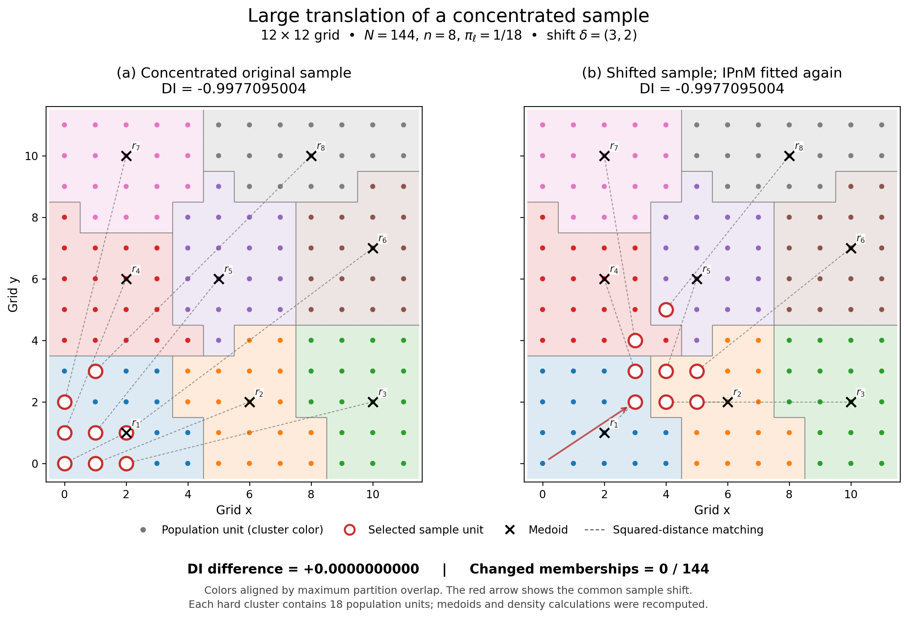

# Concentrated samples and large translations

**Finding:** all nine independently rebuilt pairs retained the same hard partition, medoids and DI. No genuinely changed-clustering example was found in this bounded experiment. Consequently, it does not determine whether DI remains invariant when the reference genuinely changes.

The population is the fixed grid `{0,...,11}²`, with `N=144`, `n=8` and equal inclusion probabilities `1/18`. Three asymmetric compact eight-point shapes were specified before fitting. All are confined to at most four rows and four columns. Each was shifted by `(3,2)`, `(4,1)` and `(2,3)`; every translated point remains a population unit.

The displayed original sample is `(0,0); (1,0); (2,0); (0,1); (1,1); (2,1); (0,2); (1,3)`, occupying three columns and four rows. Its shift is `(3,2)`. Both references are reconstructed independently from the respective eight sample coordinates.

| Component | Original | Shifted |
|---|---:|---:|
| Dnet | -0.965150742776482 | -0.965150742776482 |
| eta | 0.934274077520571 | 0.934274077520571 |
| DI | -0.997709500421261 | -0.997709500421261 |

**DI difference = 0; changed memberships = 0/144 after label alignment; adjusted Rand index = 1.** Every hard cluster contains 18 units. These are equal saved numerical values, not merely equal rounded labels.

| Compact sample | DI before and after every tested shift | Changed units |
|---|---:|---:|
| compact asymmetric L | -0.9977095004 | 0/144 |
| compact skew cross | -0.9986475651 | 0/144 |
| compact asymmetric wedge | -0.9982542933 | 0/144 |

The DI values are close to −1, but their equality is **not merely saturation**: all original/translated density counts and both components are identical. For every pair, the newly constructed translated population is exactly the old constructed population plus the common sample shift.

The calculation uses the manuscript-style sample-initialized entropic OT, cost-median scaling, hard IP balancing, squared-distance medoids and squared-distance matching, followed by the explicitly requested historical spherical Scott KDE. It does not use the package DI default. Coordinates are normalized using the whole population (`raw/11`), never the compact sample. Translated coordinates are not renormalized; densities are evaluated at their corresponding unit locations. The DI definition and sign are unchanged.

Settings: solver seed 17, OT epsilon 0.01, outer tolerance `1e-10`, marginal tolerance `1e-12`, standard 15 OTSP restarts, one thread. The displayed pair was independently repeated at outer/marginal tolerances `1e-12`/`1e-13`, with unchanged results. Preliminary assignments are well separated: all saved maximum-versus-runner-up coupling margins exceed 0.022. Matching is uniquely optimal for all primary fits. One exact medoid tie occurs in the displayed reference and follows the manuscript smallest-label rule. Tied OTSP routes cannot change these memberships because every preliminary group already has exactly 18 units (IP mass one).

Independent checks verified 16 saved fits: 12 primary, two tighter fits, one replay and one joint-coordinate control. They include exhaustive eight-point matching/TSP checks, direct spherical neighbor counts, label-independent co-membership matrices and OT convergence/stationarity checks. Density components agree with independent scalar calculations within 1.2e-15.

**Interpretation:** this provides a concentrated-sample, large-shift example of invariance with an unchanged reference. Neither “different clustering, same DI” nor “different clustering, different DI” was observed. It is not a general invariance proof, and no changed-clustering example was forced.

Files: [PDF figure](translation_comparison.pdf), [nine-row CSV](summary.csv), [memberships](display_memberships.csv), [medoids and matching](display_references.csv), [verification](verification.json), and [method details](METHODS.md). All candidates, shifts, seeds, scripts and per-run states are retained. Completed fits are skipped on resume. No manuscript, reviewer response, GFS package, previous figure, dataset or saved study result was modified; all 5,463 protected-file hashes match.
