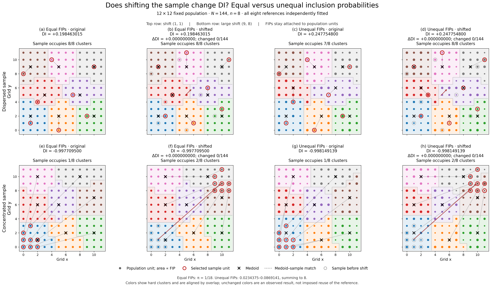

# Grid sample translation: equal versus unequal inclusion probabilities

**Finding:** DI is unchanged under all four illustrated sample translations. Each original and shifted sample received a new, independent complete IPnM fit. All four hard partitions are unchanged after label alignment; this experiment does not demonstrate invariance when the reference itself changes.



| Sample | FIPs | Shift | DI before | DI after | Difference | Changed memberships |
| --- | --- | --- | ---: | ---: | ---: | ---: |
| dispersed | equal | (1,1) | 0.198463015435 | 0.198463015435 | 0.000000000000 | 0/144 |
| dispersed | unequal | (1,1) | 0.247754799558 | 0.247754799558 | 0.000000000000 | 0/144 |
| compact | equal | (9,8) | -0.997709500421 | -0.997709500421 | 0.000000000000 | 0/144 |
| compact | unequal | (9,8) | -0.998149139024 | -0.998149139024 | 0.000000000000 | 0/144 |

The first row reuses the **sample geometry** from the earlier dispersed example: `(1,1),(5,0),(9,2),(2,4),(7,5),(0,8),(4,10),(10,9)`, shifted by `(1,1)`. Its equal-FIP original and shifted samples occupy all eight reference clusters. With unequal FIPs, the original occupies seven clusters and the shifted sample eight.

The second row uses the earlier compact asymmetric shape: `(0,0),(1,0),(2,0),(0,1),(1,1),(2,1),(0,2),(1,3)`, shifted by `(9,8)` into the top-right corner. The original occupies one cluster; the shifted sample occupies two, under both FIP settings. These occupancy counts describe where the sample falls in the population partition; they do not mean that the partition changed.

## Inclusion probabilities

The population is `{0,...,11}²`, with 144 units and sample size eight. Equal FIPs are `1/18`. A **single unequal vector** is frozen for both sample shapes and all their shifts. Seed 20261016 generates integer weights in `[24,89]`, followed by a deterministic sum correction to 8192; `pi_i=w_i/1024`. The resulting FIPs range from 0.0234375 to 0.0869140625, sum **exactly to eight** in binary arithmetic, and all lie strictly between zero and one. The construction was fixed before any fit and was not selected to produce invariance.

`population_FIPs.csv` gives all 144 coordinates, equal/unequal FIPs and integer weights. Point area in the main figure is proportional to FIP on a common scale. FIPs remain attached to fixed population units: a moved sample point acquires the FIP of its new unit. The illustrated samples are deliberately chosen configurations, not random draws whose selection frequencies estimate these FIPs.

## Procedure and numerical controls

All **eight primary references were fitted anew**, including the four equal-FIP panels; no prior partition was reused. Starting centers are the eight observed sample coordinates. The isolated manuscript-style method uses sample-initialized entropic OT (epsilon 0.01, squared costs divided by their median), seeded open-TSP ordering with 15 restarts, the existing stable within-cluster order, cumulative-IP border splitting, hard assignment to the larger share, weighted **squared-distance** medoids, and optimal **squared-distance** matching. Exact medoid ties select highest FIP, then smallest population ID. Exact hard-share ties select the smallest persistent cluster index; none occurs in these fits.

Equal-FIP overlap is computed exactly using weights 1/18. Unequal-FIP overlap is computed exactly using integer numerators and denominator 1024. The soft clusters have IP mass exactly one; hard cluster totals can differ from one after border hardening. These totals, medoids and matching are saved in `display_references.csv`. Unequal FIPs affect clustering, quota refinement and weighted medoids; they are **not used as KDE weights**.

Density calculations use the historical unweighted spherical top-hat KDE and scalar Scott bandwidth `h=144^(-1/6)` on population-normalized coordinates `raw/11`. The same numerical bandwidth is used before and after internal cluster translations, with no renormalization of the internally translated configuration. Each density is evaluated at its corresponding unit locations. The existing Dnet, eta and DI definitions and signs are unchanged.

Primary outer/marginal tolerances are 1e-10/1e-12. All four unequal-FIP panels were independently refitted at 1e-12/1e-13; hard partitions, medoids, matching, density counts and DI remain unchanged. A same-seed unequal-FIP replay and a full joint-coordinate translation control also agree. Total: eight primary fits plus six controls, one thread and one worker. No original Monte Carlo or completed 480-run sensitivity experiment was rerun.

Independent checks verified all 14 saved states: exact rational IP overlaps; exhaustive 8! squared matchings and open paths; weighted medoid objectives/ties; OT marginal, fixed-point and dual-stationarity residuals; label-independent co-memberships; scalar spherical-neighbor counts; and Dnet/eta/DI. Every saved TSP path attains the exhaustive shortest length for its eight saved centroids. Preliminary OT assignment margins exceed 0.00286474. Unequal-FIP medoids and hard shares have no exact ties. The equal grid retains some exact medoid/route ties, resolved by the recorded conventions; the four equal-panel results agree with their earlier saved counterparts.

There are no zero self-evaluated densities. The top-hat estimator is discontinuous at its support boundary, but every original and shifted pair has identical density counts and both components, so equality is not merely rounding or saturation near DI=-1. In each pair the internally translated populations differ by exactly the common sample shift. The frozen-reference control also gives zero DI difference.

## Interpretation

Unequal inclusion probabilities change the reference configurations and the absolute DI values relative to equal probabilities. They **do not break sample-translation invariance in these two fixed examples**. The dispersed sample remains positive; the concentrated sample remains strongly negative. None of the four shifts changes the induced hard partition, so these examples cannot settle the harder question of what happens when IPnM selects a genuinely different reference. They are deterministic illustrations, not estimates of the prevalence of invariance or a universal proof.

For a fixed reference and matching, shifting every selected point by delta adds delta to every internally translated population point. A distance-based KDE evaluated at the corresponding translated positions is unchanged; hence Dnet, eta and DI are unchanged. Squared matching has the same minimizing permutation set under this sample shift, because the change in its total cost is independent of the permutation. These conditions are satisfied by the observed reconstructed references here. Refitting IPnM does not in general guarantee those conditions for every population or initialization.

## Files and reproducibility

- `equal_unequal_translation.pdf/png`: requested 2-row × 4-column figure.
- `summary.csv`: four primary before/after comparisons, components and membership changes.
- `population_FIPs.csv`: frozen probabilities for all population units.
- `display_units.csv`, `display_references.csv`: all primary hard memberships, translated coordinates, densities, medoids and matches.
- `runs/`: complete summaries and arrays for all 14 fits; `results.csv`, `progress.json`, `run.log`, `verification.json` and source scripts preserve the work.

All 5526 protected original/source/result files retain their hashes. Existing package, manuscript, reviewer responses, datasets, old figures and studies were not edited. The current Git branch was not changed or pushed by this experiment.

From the project root (completed fits are skipped):

```bash
PYTHONDONTWRITEBYTECODE=1 .venv/bin/python DI_translation_equal_unequal_JSSAM_20261016/run_experiment.py
PYTHONDONTWRITEBYTECODE=1 .venv/bin/python DI_translation_equal_unequal_JSSAM_20261016/verify.py
PYTHONDONTWRITEBYTECODE=1 .venv/bin/python DI_translation_equal_unequal_JSSAM_20261016/make_outputs.py
```
