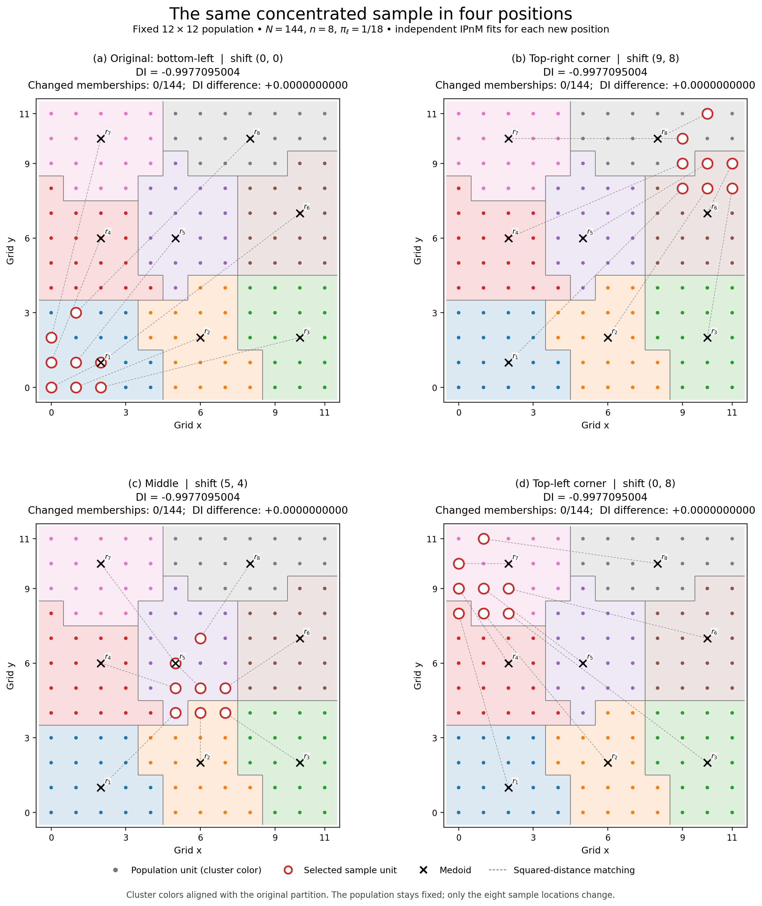

# Same compact sample in four positions

The same eight-point sample was placed in the top-right corner, middle, and top-left corner of the fixed 12×12 population. No point was rotated, reflected, wrapped, or clipped. Only a uniform translation was applied.



| Position | Shift from original | DI | Changed memberships after label alignment |
|---|---|---:|---:|
| Original, bottom-left | (0,0) | −0.9977095004212614 | 0/144 |
| Top-right corner | (9,8) | −0.9977095004212614 | 0/144 |
| Middle | (5,4) | −0.9977095004212614 | 0/144 |
| Top-left corner | (0,8) | −0.9977095004212614 | 0/144 |

Original sample: (0,0), (1,0), (2,0), (0,1), (1,1), (2,1), (0,2), (1,3). Every translated point is a valid unit of the same population. The top-right sample occupies x=9..11 and y=8..11; the middle sample occupies x=5..7 and y=4..7; the top-left sample occupies x=0..2 and y=8..11.

Each new placement independently reruns the full sample-initialized manuscript-style OT/IPnM reference procedure, including OTSP ordering, exact EP quota refinement, hard clustering, squared-distance medoids and optimal squared-distance matching. The original saved reference and its tighter control are reused unchanged from the preceding concentrated-sample study; the three new placements and their tighter controls are six new full fits.

N=144, n=8, pi=1/18, solver seed17, OT epsilon0.01, outer/marginal tolerances1e-10/1e-12, and15 OTSP restarts are unchanged. Each placement was also fitted at1e-12/1e-13 tolerances. Historical spherical Scott KDE uses coordinates normalized by the whole population (raw/11), the same bandwidth before/after internal translation, and density evaluations at each configuration's corresponding unit locations. The DI definition/sign are unchanged.

All three new placements preserve the hard partition and medoids. Every cluster has18 units. Matching is unique, and preliminary assignments are well separated. The known exact medoid tie follows the manuscript smallest-label rule. OTSP route choices cannot affect memberships here because every preliminary cluster already has18 units. Label-independent pairwise co-membership checks and tighter fits confirm the result.

The equality is not just final-index saturation: the original and translated density counts, Dnet=−0.9651507427764816 and eta=0.934274077520571, are identical. The reconstructed translated populations differ from the original reconstruction by exactly the respective shift.

Saved-state verification checks all eight states (two original saved states and six new fits), including exhaustive squared matching, medoid costs, spherical counts, DI components, OT convergence and dual stationarity. These illustrated placements support invariance with unchanged references; they do not establish a universal theorem.

Files: [PDF](four_positions.pdf), [PNG](four_positions.png), [CSV](summary.csv), [verification](verification.json). Inputs and settings: config.json. Individual states: runs/.

Reproduce or inspect from the project root:
```bash
PYTHONDONTWRITEBYTECODE=1 .venv/bin/python DI_translation_positions_JSSAM_20261016/verify.py
PYTHONDONTWRITEBYTECODE=1 .venv/bin/python DI_translation_positions_JSSAM_20261016/make_figure.py
```

The manuscript, package, reviewer responses, and all previous results and figures remain unchanged. Every protected input file retains its hash. All work uses one thread and one worker.
