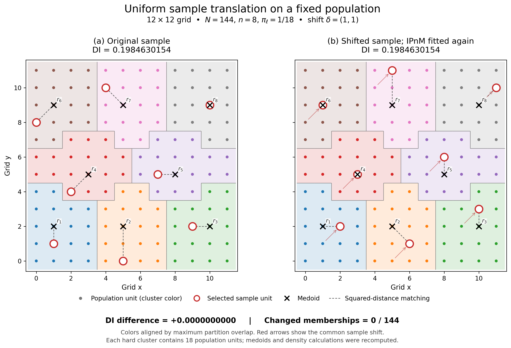

# Sample translation on a12x12 grid: visual IPnM experiment

16 October2026. **Result: no change found.** Five asymmetric eight-point samples were each shifted by(1,1),(1,0),(0,1). Every shifted sample was fitted independently. All15 comparisons retained the same hard partition after optimal cluster-label alignment, with exactly identical computed DI. No result was forced, and the search stopped after the five prespecified candidates.



## Displayed example

Population U={(x,y):x,y=0,...,11}; N=144,n=8 and pi_l=1/18. The original sample is

```text
(1,1), (5,0), (9,2), (2,4), (7,5), (0,8), (4,10), (10,9)
```

The displayed translation is delta=(1,1). Every new point remains in U. This sample has no nonidentity square-grid symmetry. The reference clusters have irregular stepped boundaries, shown as discrete grid-cell boundaries in the figure.

| Quantity | Original | Shifted |
|---|---:|---:|
| Dnet | 0.151552427008120 | 0.151552427008120 |
| eta | 0.055289908204499 | 0.055289908204499 |
| DI | 0.198463015435170 | 0.198463015435170 |

**DI difference=0; changed memberships=0/144; adjusted Rand index=1.** This is equality of the saved computed values, not merely equality after rounding. The original population remains fixed in both panels. Colors were aligned by maximum partition overlap, and equality was independently checked using the complete pairwise co-membership matrices.

| Cluster | Units | Medoid | Matched original point | Matched shifted point |
|---|---:|---|---|---|
|1|18|(1,2)|(1,1)|(2,2)|
|2|18|(5,2)|(5,0)|(6,1)|
|3|18|(10,2)|(9,2)|(10,3)|
|4|18|(3,5)|(2,4)|(3,5)|
|5|18|(8,5)|(7,5)|(8,6)|
|6|18|(1,9)|(0,8)|(1,9)|
|7|18|(5,9)|(4,10)|(5,11)|
|8|18|(10,9)|(10,9)|(11,10)|

The matching permutation is[0,1,2,3,4,5,6,7] in both states. Every internal cluster displacement increases by exactly delta. Consequently, the entire constructed translated population moves by delta and its self-evaluated KDE values remain unchanged unit by unit. Unit-level memberships and the complete reference table are saved separately as CSV files.

## Bounded alternatives

Candidate1 above was specified directly. Four additional asymmetric samples were frozen from RNG seed20261016 before any fit. Every candidate lies inside the0..10 subgrid so all three positive one-step shifts are valid. Solver seed17 and settings were held fixed across all pairs; selection was based on partition changes, never DI magnitude or sign.

| Sample | Original DI | Changed units for(1,1)/(1,0)/(0,1) | Largest absolute DI difference |
|---|---:|---|---:|
|1|0.1984630154|0/0/0|0.0|
|2|-0.6557731998|0/0/0|0.0|
|3|-0.2111939697|0/0/0|0.0|
|4|-0.4760733967|0/0/0|0.0|
|5|-0.5941352609|0/0/0|0.0|

All sample coordinates and seeds are preserved in config.json; all individual results, including the unchanged alternatives, are retained. The five candidates can induce different references from one another, but no original-versus-uniformly-shifted pair induced a different partition.

## Method and numerical checks

The available12October Measure snapshot defines sample-adaptive entropic squared-distance OT with costs divided by their median, followed by centroid OTSP ordering, exact cumulative-IP balancing, hard clusters, squared-distance medoids and squared-distance matching. This study implements those equations in an isolated module, using the current package OTSP/within-cluster ordering and the existing stabilized Sinkhorn/Newton helpers for the same entropic OT problem. It does not call the package DI default, which uses a different preliminary method. The requested historical spherical KDE is an explicit exception to the box-kernel paragraph in that manuscript snapshot; no unseen later manuscript edits are certified.

Coordinates use the historical normalization raw/11. The historical KDE is KernelDensity(kernel="tophat",bandwidth="scott",rtol=1e-4), with h=144^(-1/6)=0.436790232368149. It has spherical support and equal unit weights. Original and internally translated estimates use the same numerical bandwidth; internally translated coordinates are not renormalized. The density pair is f(c_l),g(c_tilde_l), evaluated at each configuration's own unit locations. The manuscript Dnet,eta,DI definition and sign convention are unchanged.

OT epsilon=.01; outer tolerance1e-10; marginal tolerance1e-12; outer limit2000. The displayed pair was independently rerun at1e-12 outer and1e-13 marginal tolerances. OTSP retains the existing randomized nearest-neighbor heuristic,2-opt and15 restarts, with a fixed seed. EP quota overlaps and squared grid objectives use exact integer arithmetic to avoid floating ties in medoid/matching costs. Equal-IP medoid ties choose the smallest population label, as specified in the manuscript. All fits use one thread and one worker, well below the approximately55% machine CPU budget.

- Verified24 saved full fits:20 primary,2 tighter controls,1 same-seed replay and1 joint-coordinate control.
- Maximum row/column marginal errors:3.96e-16/1.55e-15; maximum final centroid residual:1.12e-11.
- Independent dual-stationarity residual<=1.33e-15.
- Preliminary maximum-versus-runner-up coupling margin>=0.022262: no near-tied preliminary hard assignments.
- Exhaustive evaluation of all8! matchings confirms the saved squared optima; displayed matching is unique, with original costs13 versus35 for the best and second assignment, in raw squared-grid units.
- Exhaustive8-node open-TSP checks agree with the heuristic route length within4.44e-16.
- Direct spherical-neighbor counts and an independent scalar recomputation of Dnet,eta,DI agree within5.27e-16. No self-densities are zero.
- Same-seed replay and common coordinate shift(8,-4) reproduce the displayed scientific states. The separate density-only control shifts the saved internally translated population and confirms unchanged KDE/DI; it does not constitute another matching search.

Ties were not hidden. The displayed reference has four exact medoid ties, resolved by the manuscript rule; its squared matching is unique. Symmetry-related optimal OTSP routes also exist. They cannot affect hard membership in this experiment: every preliminary cluster already has18 units, exactly IP mass1, so any whole-cluster path order and any within-cluster ordering preserve its membership under quota cuts. All24 saved preliminary and final partitions satisfy this property. Tighter tolerance checks leave memberships, medoids and DI unchanged. Some alternative samples have exact matching ties, consistently resolved lexicographically; all those outcomes are retained.

## Interpretation and limit

For these asymmetric samples on the specified regular population, independent full reference reconstruction preserves the reference partition and DI under each tested shift. This is a controlled illustration of invariance with an unchanged reference, not a general theorem. **No genuinely changed-clustering pair was found. Therefore this experiment cannot determine whether DI stays invariant when the sample-adaptive clustering genuinely changes.** That conditional research question remains unanswered by this bounded experiment; it would be incorrect to claim the figure answers it.

## Files and reproducibility

Figure: translation_comparison.pdf and translation_comparison.png. Main report: REPORT.md. Evidence: results.csv,comparisons.json,controls.json,verification.json,display_memberships.csv,display_references.csv,runs/*/summary.json and state.npz. Config and seeds are frozen in config.json. Every completed fit is saved immediately and skipped on resume. An unused inherited helper was removed during final source cleanup; executed_source/ preserves the exact executed module/configuration, and all scientific functions/settings and completed results are unchanged.

From the project root:
```bash
PYTHONDONTWRITEBYTECODE=1 .venv/bin/python DI_translation_visual_JSSAM_20261016/verify.py
# Rebuild the figure from saved results only:
PYTHONDONTWRITEBYTECODE=1 .venv/bin/python DI_translation_visual_JSSAM_20261016/make_figure.py
# Safe resume/status check: completed experiment fits are skipped.
PYTHONDONTWRITEBYTECODE=1 .venv/bin/python DI_translation_visual_JSSAM_20261016/run_experiment.py
```

No manuscript, reviewer response, GFS package, original simulation, old figure, dataset or completed sensitivity result was changed. All5,387 pre-existing protected-file hashes remain unchanged. No claims about historical Monte Carlo seed handling are made.
