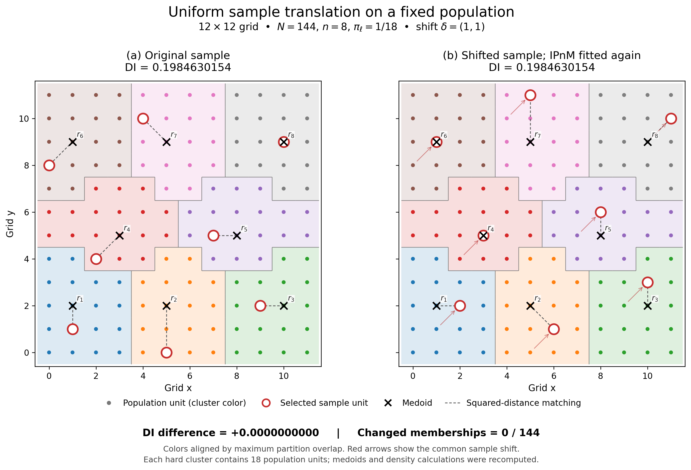

# 12×12 sample-translation experiment

**Finding:** all 15 tested shifts preserved the hard partition and DI. No pair with genuinely changed clustering was found, so this experiment cannot answer whether DI is invariant when the reference changes.

The population is U={0,...,11}^2, N=144, n=8, pi=1/18. The displayed asymmetric sample is (1,1),(5,0),(9,2),(2,4),(7,5),(0,8),(4,10),(10,9). It is shifted by(1,1), with every new point remaining in U. Both references are reconstructed independently from their respective sample centers.

| Quantity | Original | Shifted |
|---|---:|---:|
| Dnet | 0.151552427008 | 0.151552427008 |
| eta | 0.055289908204 | 0.055289908204 |
| DI | 0.198463015435 | 0.198463015435 |

**DI difference=0; changed memberships=0/144 after cluster-label alignment; adjusted Rand index=1.** Every cluster has 18 units. Medoids and the unique squared matching are unchanged, and each internal cluster displacement increases by exactly the common sample shift.

Four additional asymmetric samples were specified before fitting (seed 20261016). All five samples were shifted by (1,1), (1,0), and (0,1), using the same solver seed 17. Every comparison reruns the complete reference procedure; no pair was selected by DI magnitude or sign.

| Sample | DI for original and all 3 shifts | Changed memberships |
|---|---:|---:|
|1|0.1984630154|0/144|
|2|-0.6557731998|0/144|
|3|-0.2111939697|0/144|
|4|-0.4760733967|0/144|
|5|-0.5941352609|0/144|

The calculation follows the manuscript OT equations, median cost scaling, ordered IP balancing, squared medoids/matching and original DI definition, with the explicitly requested historical spherical Scott KDE. Coordinates are normalized as raw/11; translated coordinates are not renormalized. Each density is evaluated at its own configuration's unit locations. All source data and settings are saved locally.

OT uses epsilon=0.01, outer tolerance 1e-10 and marginal tolerance 1e-12. Tighter 1e-12/1e-13 controls preserve the displayed result. Independent checks verify 24 saved fits, including replay and joint-coordinate controls. Preliminary assignment margins exceed 0.022, and direct spherical counts reproduce the densities and DI.

The grid still induces exact medoid ties and symmetry-related OTSP routes. Medoid ties follow the manuscript smallest-label rule. Every preliminary cluster already contains 18 units, so alternative OTSP routes cannot affect quota-refined memberships here. These are not hidden numerical assignment ties.

**Interpretation:** this is a visual illustration of unchanged-reference translation invariance, not a proof of general sample-only invariance. Five bounded alternatives did not produce a genuinely changed-clustering example; no result was forced.

Files: [vector PDF](translation_comparison.pdf), [numerical checks and full method](METHODS_AND_CHECKS.md), [all results](results.csv), [displayed memberships](display_memberships.csv), [medoids and matching](display_references.csv). Scripts and per-run states are retained. Completed fits are skipped on resume.

No manuscript, reviewer response, GFS package, original simulation, old figure or saved study result was changed. All 5,387 protected-file hashes remain unchanged.
