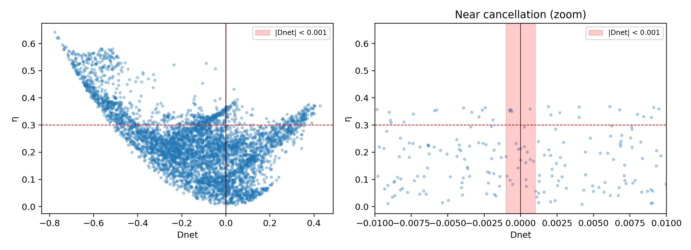
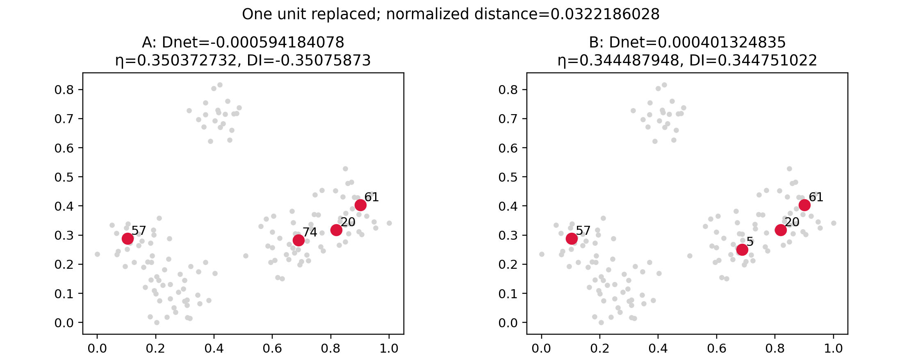
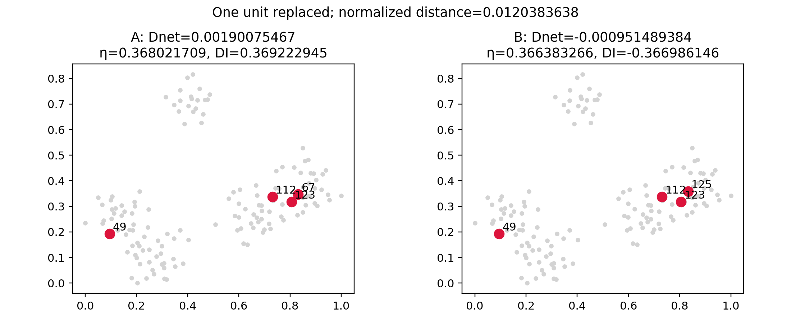

# Empirical investigation of DI cancellation and sign instability

## Answers

1. **Yes, at the requested empirical threshold.** Five of 5,000 SRS samples (0.1%) satisfy |Dnet| < 0.001 and η > 0.3. Among the 1146 samples with η > 0.3, the minimum |Dnet| is **0.00059418407787305131**. This establishes coexistence in this population, not arbitrarily small attainable values or a universal limit.
2. **Yes, for similar feasible samples.** Replacing one unit at normalized distance 0.032218602793298849 changes DI by **0.69550975198077269**, with both |Dnet| below 0.001 and both η above 0.34. A second pair replaces a unit at distance 0.012038363832856362 and changes DI by 0.7362090906986436. Both pairs retain three of four units. Their scores are identical under the saved reproducibility seed and each of ten common alternative clustering seeds (0–9).
3. **This is a material local interpretation problem.** DI can switch between moderately large negative and positive values for closely related samples with almost cancelling net density distortion. A scalar DI near ±0.35 must not be read as an unambiguous, smoothly varying ordering of spatial spread near cancellation. The strict event is uncommon in this SRS run, but its low frequency does not remove the demonstrated local sensitivity. Report Dnet and η alongside DI when interpreting this regime. These results do not establish that the index is unusable everywhere, or estimate rates under other sampling designs.

## Construction and reproducibility

Used the repository package directly: Population → DensityDisparity(representative="nmedoids") → FIPBalancedNMeans(init_clust_method="weighted", tol=1e-9, max_iter=100), initialized by each realized sample → package balanced-cluster construction → package weighted medoids → Euclidean Hungarian matching → cluster translation → package KDE → package DI. The public default is nmeans, so nmedoids is selected explicitly as requested. No package source, existing scripts, datasets, or previous results were changed.

Population: `simulations/populations/simulated/clust_N144_perm.csv` (N=144), the permuted clustered population referenced by existing simulations; SHA256 `af612c0dc9df3b9296202d217d6d836c0f1e3ba9faf481691c9f7b6fec6c36a3`. File rows have no ID column: IDs are the package defaults 1–144 in file order; indices are 0–143. Population subtracts the coordinate-wise minima and divides both axes by the largest original axis span. CSVs contain both raw and package-normalized coordinates.

Sampling: 5,000 independent simple random subsets of size four without replacement, NumPy default_rng(12345), sorted within sample. All 5,000 realized subsets were distinct. Each unit has inclusion probability 4/144. NumPy is used because package RandomSampling.sample draws with replacement. This is a specified SRS experiment, not a pooled comparison of spread-oriented designs. For package-internal random steps, each subset uses SeedSequence([12345, *sorted_indices]) to seed NumPy and Numba; seeds are recorded. No sampling weights from the file are used in the equal-probability experiment.

Software versions and input hash are in `manifest.json`. Reproduce from repository root:

```bash
MPLCONFIGDIR=/tmp/mpl-di .venv/bin/python simulations/di_cancellation_experiment_20261012.py
MPLCONFIGDIR=/tmp/mpl-di .venv/bin/python simulations/di_cancellation_audit_20261012.py
MPLCONFIGDIR=/tmp/mpl-di .venv/bin/python simulations/di_cancellation_report_20261012.py
```

## Definition and bandwidth audit

Let f_i be the original population KDE evaluated at its original unit coordinates, and g_i the translated KDE evaluated at the translated coordinates of the corresponding units. Both are unweighted top-hat KDEs, fitted to all N=144 points, with bandwidth="scott" and rtol=1e-4. The sklearn Scott bandwidth is N^(-1/(d+4)) = 144^(-1/6) = **0.43679023236814946** in normalized coordinates. It is the same for both fits; no sample-size bandwidth, adaptive choice, or additional coordinate rescaling is introduced after translation.

The intermediate values are recovered from the package's returned densities with its exact elementwise operations:

```
u_i = 1 / (sqrt(2) sqrt(f_i² + g_i²))
Dnet = mean(clip((f_i - g_i) u_i / sin(π/8), -1, 1))
η = mean(clip((1 - (f_i + g_i) u_i) / (1 - cos(π/8)), -1, 1))
DI = Dnet + (sign(Dnet) - Dnet) η
```

Clipping occurs **before** averaging. η is the implemented scaled cosine distortion, not a separately estimated density variance. The maximum absolute discrepancy from `(1−η)Dnet + η sign(Dnet)` over all 5,000 draws is **1.1102230246251565e-16**, consistent with floating-point evaluation order. For the four illustrated samples, independent trigonometric calculations using θ_i=atan2(g_i,f_i) agree within 5e-15. Seeded reruns reproduce their saved scores exactly.

**Manuscript comparison remains pending:** no current JSSAM manuscript was found in the repository or supplied during this run. The audit certifies the actual package construction and the identity supplied in the task, not line-by-line agreement with an unavailable manuscript. In particular, the bandwidth, per-unit clipping, hard cluster labels, and explicit medoid choice should be checked against that document before using these findings in the paper.

## Near-cancellation samples in the random experiment

All five samples meeting the requested strict thresholds:

| draw | IDs | Dnet | eta | DI |
| --- | --- | --- | --- | --- |
| 2437 | 20, 57, 61, 74 | -0.00059418407787305131 | 0.35037273225371657 | -0.35075873043276357 |
| 3785 | 34, 43, 55, 102 | 0.00063821115884201329 | 0.36008904820640691 | 0.36049744651650678 |
| 2352 | 24, 34, 97, 123 | -0.00067092457488400015 | 0.35695277133956871 | -0.35738420752808803 |
| 1341 | 63, 64, 105, 130 | -0.00074226004064743064 | 0.35091386548697273 | -0.35139565618756002 |
| 84 | 38, 49, 103, 105 | -0.00075579228786495001 | 0.3570454030054071 | -0.35753134313126295 |

`near_cancellation.csv` lists the twenty closest high-η samples, with IDs and coordinates. `random_samples.csv` contains all 5,000 draws at 17 significant digits. No small value is rounded to zero. Exactly 0 random draws have Dnet numerically equal to zero.



The plot shows all draws and a ±0.01 zoom, with the requested ±0.001 strip highlighted. Near-zero Dnet is compatible with a range of η: 21 draws have |Dnet| < 0.001, five of them with η > 0.3. `joint_distribution.csv` reports bin counts, median/max η, and high-η counts. For |Dnet| < 0.01 there are 188 draws, including 31 with η > 0.3. The evidence already answers the primary coexistence question, so no optional n=8 or unequal-probability extension was needed.

## Similar samples and targeted search

After the SRS run, selected the three smallest-|Dnet| high-η samples of each sign. Enumerated all 4×140 one-unit replacements for each of these six anchors: 3360 comparisons. This targeted selection is deliberately favorable to finding counterexamples; its hit rate is **not** an unbiased estimate of population-wide instability. Across random and local stages, 8359 distinct subsets were evaluated. Full replacements and all qualifying opposite-sign pairs are saved separately.

Illustration 1 minimizes the larger absolute Dnet across qualifying searched pairs. Illustration 2 minimizes replacement distance among searched pairs with both |Dnet| < 0.01. These are search-specific extrema, not global optima across all feasible subsets.

| sample | IDs | Dnet | eta | DI |
| --- | --- | --- | --- | --- |
| 1A | 20, 57, 61, 74 | -0.00059418407787305131 | 0.35037273225371657 | -0.35075873043276357 |
| 1B | 5, 20, 57, 61 | 0.00040132483542619653 | 0.3444879482817334 | 0.34475102154800913 |
| 2A | 49, 67, 112, 123 | 0.0019007546713664977 | 0.3680217093163145 | 0.36922294500453373 |
| 2B | 49, 112, 123, 125 | -0.00095148938387140669 | 0.36638326609835919 | -0.36698614569410992 |

Pair 1 replaces ID 74 with ID 5, moving only 3.22186028% of the largest population axis span. The absolute Dnet change is 0.00099550891329924784; the DI change is 0.69550975198077269. Its sign-dependent term contributes η_A+η_B = 0.69486068053545003 to the gap; the remaining contribution is only 0.00064907144532266869. Thus almost the entire gap comes from the formula's sign term. This decomposition does not assume a fixed reference clustering along a continuous path: both samples are fully reclustered by the package.



Pair 2 replaces ID 67 with ID 125, moving 1.20383638% of the largest span.



The repeated-seed checks in `rng_sensitivity.csv` found no variation for either illustrative pair, supporting a geometric sample change rather than a random initialization explanation for these examples. This does not establish seed independence for every sample.

## Mathematical discontinuity versus observed instability

For a fixed η>0, the formula has one-sided limits −η and +η as Dnet approaches zero, while sign(0)=0 gives DI=0 exactly. This algebraic discontinuity is unconditional for that fixed-η extension of the formula. It does not by itself prove that a particular finite population's feasible samples attain Dnet=0 with η>0 or approach zero arbitrarily closely.

The observations supply the missing practical evidence at the requested finite threshold: actual KDEs from actual feasible samples produce near cancellation with substantial η, and one nearby unit replacement reverses the sign and produces a large index difference. No fabricated angles/densities or continuously moved off-population points were used. The finite support, top-hat KDE neighborhood changes, sample-dependent clustering, and medoid/matching choices mean this experiment is not a proof of a continuous geometric limit or a decomposition of every source of non-smoothness. It demonstrates a concrete local sensitivity, with the final sign term accounting for almost all of the illustrated DI gap.

The defensible interpretation is that net direction and remaining distortion are distinct quantities: cancellation in the former can coexist with substantial latter distortion. DI combines them in a way that makes its sign and magnitude sensitive near that boundary. The present evidence warrants substantive care in interpreting DI alone; it does not justify dismissing the reviewer’s concern as merely hypothetical.

## Artifacts and checks

- `random_samples.csv`: complete main experiment, including Dnet, η, DI, numerical identity error, unit IDs, indices, and both coordinate systems.
- `near_cancellation.csv`, `joint_distribution.csv`: relevant cases and joint-distribution summaries.
- `local_search.csv`, `opposite_sign_pairs.csv`: targeted comparisons, explicitly separate from SRS.
- `eta_vs_Dnet.png`, `spatial_pair_1.png`, `spatial_pair_2.png`: figures.
- `pair_*_densities.npz`: actual original/translated densities for illustrative samples.
- `population_and_samples.npz`: normalized/raw coordinates, inclusion probabilities, IDs and all sampled subsets.
- `manifest.json`, `audit.json`, `rng_sensitivity.csv`, execution logs: provenance and verification evidence.

Audit passed: reproduced the seeded sampling stream, checked unique in-range units per sample, verified the identity on all 5,000 rows, checked η bounds, reran illustrative package scores, checked the angular equivalent using actual densities, and verified the Scott bandwidth. This report is an investigation, not a response to the reviewer.
